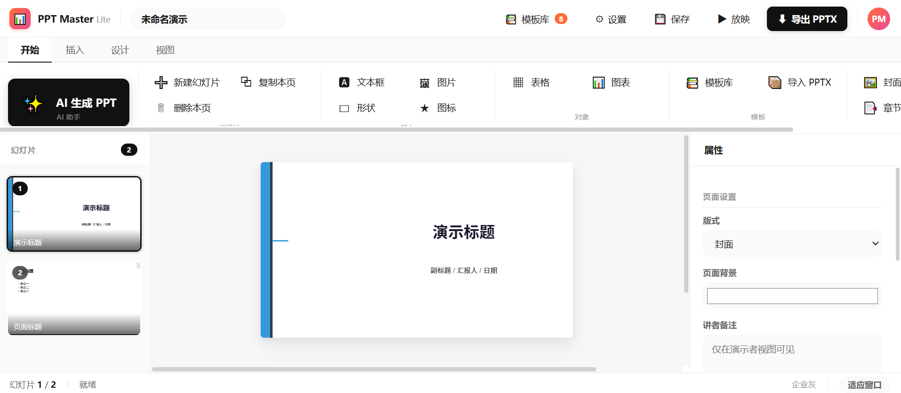

# PPT Master Lite — AI-Powered PPT Generator in the Browser

English | [中文](./README.md)

Drop in a PDF, Word document, web URL, or plain text — AI automatically generates a beautifully designed presentation that's **natively editable in PowerPoint**. Runs entirely in your browser, no installation, no server, data stays local.

> **Open and use**: Save the single HTML file locally, double-click to start creating presentations.

---

## What Problem It Solves

Most AI PPT tools produce two types of output: image-based exports (view-only, not editable) or template-fill results (layout locked). 

PPT Master Lite takes a third path — it outputs **natively editable PowerPoint**: shapes with adjustment handles, real text boxes, and data-driven charts that can be edited in PowerPoint / Keynote / WPS.

> Editability is already the baseline — what truly sets things apart is native depth. PPT Master Lite hands you a real PowerPoint: slide masters, native shapes, and data-backed charts, not a bunch of flat text boxes.

It doesn't just make slides look good — **it helps you organize your thinking first, then talks about visuals**.

---

## Core Features

### 🎯 AI-Powered Generation

- **Multi-format input**: PDF, DOCX, TXT, Markdown, web URLs, or direct text paste
- **Multi-file analysis**: Upload multiple files at once, AI automatically aggregates and analyzes
- **Two-step generation flow**:
  - Step 1: AI analyzes materials and outputs a structured outline (editable inline)
  - Step 2: After user confirmation, AI generates detailed content for each page
- **Auto image generation**: Optional per-page image generation via Pollinations

### 🎨 Theme & Template System

- **8 built-in themes**: Professional, Minimal, Dark, Warm, Forest, Rose, Ocean, Corporate
- **PPTX template import**: Upload any `.pptx` file, auto-parse theme colors and fonts
- **Three master layouts**: COVER, CONTENT, SECTION, each with distinct decorations

### ✏️ Visual Online Editing

- **WYSIWYG**: Drag to move, drag handle to resize, double-click to edit text
- **Property panel**: Modify font, size, color, alignment, position
- **Element types**: Text, Shape, Table, Chart, Image, Emoji
- **Chart support**: Bar, Line, Pie — data editing with synchronized preview and export

### 📤 Native PPTX Export

- Generate `.pptx` files client-side using PptxGenJS
- **Master decorations**: Native slide masters with `defineSlideMaster()`
- **Speaker notes**: Written via `addNotes()`
- **Transitions**: Fade, Push, Wipe
- All exported elements are editable in PowerPoint

### 💾 Project Saving

- Save as HTML file with JSON data embedded
- Reopen to continue editing
- Auto-save to localStorage

---

## Quick Start

### How to Open

1. Save this project as an HTML file (e.g., `ppt-master-lite.html`)
2. Double-click to open in Chrome / Edge / Firefox
3. Start using immediately

> No installation, no registration, no server required.

### Configure API

1. Click "⚙ Settings" in the top-right corner
2. Enter OpenAI-compatible API URL, Key, and model name
3. Presets: OpenAI / DeepSeek / Kimi / Zhipu / Ollama
4. Configuration saved in localStorage

### Generate Your First PPT

1. Click "✨ AI Generate PPT"
2. Choose source: Paste Text / Upload File / Web URL
3. Set target page count, style, and theme
4. Click "Start Analysis"
5. Review the AI-generated outline — edit titles and points inline
6. Click "Confirm & Generate"
7. Content generated page by page (with progress bar and live log)
8. Click "Enter Editing" when done

### Manual Editing

- Bottom toolbar: Text / Shape / Table / Chart / Image / Icon
- Drag to move, resize, double-click to edit text
- Right panel: modify all properties
- Top "🎨 Theme": switch color schemes
- "📦 Import Template": upload PPTX templates

### Export

- "⬇ Export PPTX" — generate native PowerPoint file
- "💾 Save" — save as HTML project file

---

## Technical Architecture

### Frontend Stack

| Technology | Purpose |
|---|---|
| PptxGenJS | Client-side PPTX generation |
| Chart.js | Chart preview rendering |
| PDF.js | PDF parsing |
| mammoth.js | DOCX parsing |
| JSZip | PPTX template unpacking |

### Core Design

- **Single HTML file**: All CSS/JS inline, external libs via CDN
- **Data model**: Slides stored as JSON, mapped directly to PptxGenJS objects on export
- **Coordinate system**: 1 inch = 96 CSS pixels, matching PptxGenJS coordinates
- **Master system**: COVER / CONTENT / SECTION masters via `defineSlideMaster()`

### Workflow
User imports material → AI analyzes & generates outline → User confirms → AI generates content per page → Online editing → Export PPTX

---

## Theme System

### Built-in Themes

| Theme | Primary | Accent | Style |
|---|---|---|---|
| Professional | #1A1A2E | #E94560 | Professional |
| Minimal | #333333 | #007AFF | Clean, Modern |
| Dark | #1A1A2E | #00D4AA | Tech, Cool |
| Warm | #3D2C1E | #FF7A45 | Warm, Vibrant |
| Forest | #1B3A2F | #2E9E6B | Natural, Fresh |
| Rose | #4A1F2E | #D6336C | Elegant |
| Ocean | #0B3954 | #087E8B | Deep, Calm |
| Corporate | #2C3E50 | #3498DB | Steady, Business |

### Custom Templates

Upload any `.pptx` file, the system automatically parses:
- Theme colors (6 accent colors)
- Heading and body fonts
- Master background color

Generated custom themes include corresponding master decorations.

---

## Examples

| Input | Output |
|---|---|
| 20-page industry report PDF | 10-page business presentation with charts and tables |
| Product launch article + topic | 8-page product launch deck |
| Multiple files (PDF + DOCX + TXT) | Aggregated presentation |

---

## Capabilities & Limitations

- Single HTML file, no installation, data stays local
- Client-side native PPTX generation, editable in PowerPoint / Keynote / WPS
- AI generation + manual online editing
- Master system with styled background decorations

### Limitations

- Limited support for complex SVG layouts (e.g., boolean operations, arbitrary curves)
- PPTX template import only parses theme colors and fonts, not layout placeholders
- Requires user-provided LLM API Key (OpenAI-compatible)

---

## Developer

Built on [PptxGenJS](https://github.com/gitbrent/PptxGenJS), inspired by [hugohe3/ppt-master](https://github.com/hugohe3/ppt-master).

### Build

No build tools required — edit the HTML file directly.

### Project Structure
ppt-master-lite/
├── ppt-master-lite.html # Single-file application
├── README.md # Chinese documentation
├── README.en.md # English documentation
└── LICENSE # License

---

## License

MIT License

---

## Credits

- [PptxGenJS](https://github.com/gitbrent/PptxGenJS) — Client-side PowerPoint generation
- [Chart.js](https://www.chartjs.org/) — Chart rendering
- [PDF.js](https://mozilla.github.io/pdf.js/) — PDF parsing
- [mammoth.js](https://github.com/mwilliamson/mammoth.js) — DOCX parsing
- [JSZip](https://stuk.github.io/jszip/) — ZIP unpacking
- [Pollinations](https://pollinations.ai/) — Free image generation